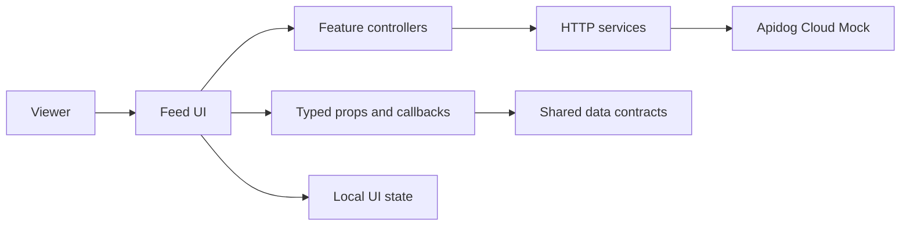
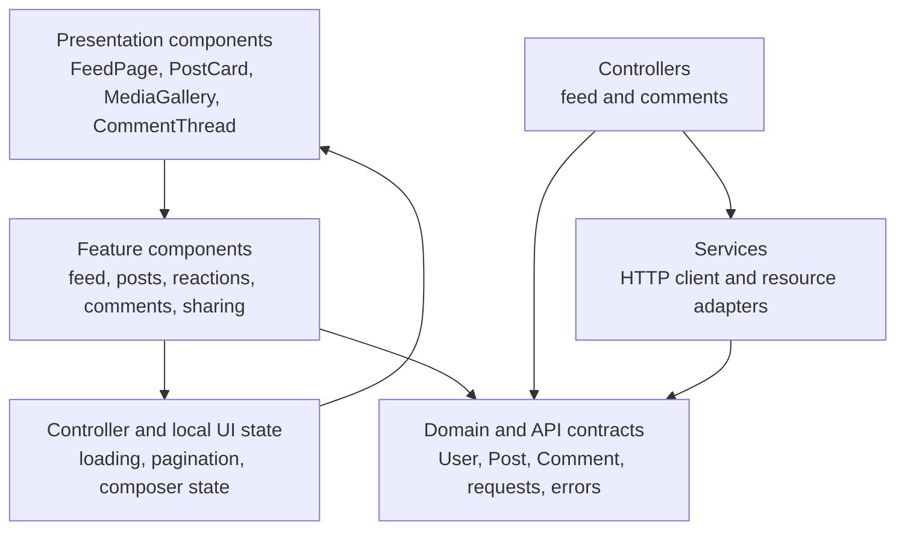

# Facebook Feed — Architecture (RADIO: A)

This is the target frontend architecture for the Stitch feed wireframe. The
implementation keeps presentation components transport-independent while
services and controllers now provide the Cloud Mock data layer.

## 1. System Context



The UI is deliberately independent of transport. A future mock or HTTP
adapter can populate the same contracts without changing the presentational
components.

## 2. Frontend Layers



### Presentation layer

Owns rendering, semantic HTML, keyboard interaction, and visual states. It
does not fetch data, mutate fixtures, or implement ownership rules.

### Feature layer

Owns feature composition such as displaying the feed, submitting a post,
setting a reaction, and rendering a comment page. It validates local inputs,
owns callback contracts, and remains independent of data access.

### State layer

Owns composer values, loading/error status supplied by the parent, selection
state, menus, and other transient interaction state. Server entities remain
separate from transient UI state.

### Contract layer

Defines the reusable TypeScript shapes in `src/types/`, based on
`data-model.md`. It is the only
shared vocabulary between components, services, fixtures, and future API
adapters.

### Service and controller layers

`src/services/` owns HTTP transport and maps the OpenAPI responses to the
contracts in `src/types/`. `src/controllers/` owns loading, pagination,
mutation orchestration, and error state. The controllers are the seam between
the transport services and presentation components, so the components do not
know whether data comes from Apidog Cloud Mock or the future backend.

The service interfaces accept an `ApiClient` adapter. Tests or a future local
mock can provide another adapter without changing controllers or components.

## 3. Component Map from the Wireframe

| Component | Responsibility | Reusable boundary |
|---|---|---|
| `FeedPage` | Coordinates feed rendering and page-level states. | Receives posts, status, pagination state, and callbacks. |
| `PostCard` | Displays author, metadata, content, media, stats, and actions. | Receives a `Post` and typed callbacks. |
| `PostHeader` | Displays avatar, name, handle, timestamp, privacy, and menu. | Receives an author and menu actions. |
| `MediaGallery` | Displays one or many image attachments and fallback states. | Receives `MediaAttachment[]`; independent of posts. |
| `PostActions` | Renders reaction, reply, share, and bookmark actions. | Receives `Post.viewer` and `Post.stats`; emits intent only. |
| `CommentThread` | Displays paginated comments and nested replies. | Receives comments, status, pagination state, and callbacks. |
| `CommentComposer` | Captures text, formatting intents, images, and parent comment. | Receives a submit callback and a `CommentComposerState`. |
| `CommentItem` | Displays author, content, media, reaction, reply, and share actions. | Works for root comments and replies. |
| `LoadMoreComments` | Requests the next cursor without replacing existing comments. | Reusable for any cursor-paginated list. |

## 4. State Ownership

| State | Owner | Lifetime |
|---|---|---|
| Feed pages and entities | `useFeedController` | Across feed renders; replaced on refresh. |
| Feed cursor and request status | `useFeedController` | While the feed is mounted. |
| Post composer values | Post composer | Until submit, cancel, or unmount. |
| Comment pages and request status | `useCommentController` | While the selected post thread is mounted. |
| Comment composer values | `App` and `CommentComposer` | Until submit, cancel, or parent changes. |
| Reaction/bookmark/share responses | `useFeedController` | Replaced with the canonical service response. |
| Open menu, selected media, edit mode | Component or feature state | Local to the active interaction. |

## 5. Data Flow and Mutation Rules

1. A parent provides `Post[]`, status, pagination state, and callbacks.
2. `FeedPage` passes each `Post` to `PostCard`.
3. Components emit intents such as `onReact(type)` or `onReply()`.
4. The controller calls a typed service and replaces local entities with the
   canonical response.
5. The service is the only layer that knows the `/api/v1` transport paths.

Presentation components must not fetch data, mutate fixtures, or reach into
transport implementations directly.

## 6. RADIO: O — Optimizations

- Use cursor pagination and append pages instead of replacing the feed.
- Cache the first feed page and stale-while-revalidate it on revisit.
- Reserve media dimensions to prevent layout shift; lazy-load below-the-fold
  images and provide `alt` text.
- Keep optimistic mutations small and reversible; never optimistically delete
  data without a rollback snapshot.
- Virtualize comments only after measurement shows that the thread needs it.
- Prefetch the next comment page when the “show more comments” control nears
  the viewport.
- Use semantic buttons and live-region announcements for loading, errors, and
  successful reactions.
- Measure initial usable paint, feed append latency, mutation failure rate,
  and image-load failures.

## 7. Suggested Folder Structure

```text
src/
├── App.tsx
├── features/
│   ├── feed/
│   │   └── components/
│   │       ├── FeedPage.tsx
│   │       └── index.ts
│   ├── posts/
│   │   ├── components/
│   │   │   ├── MediaGallery.tsx
│   │   │   ├── PostActions.tsx
│   │   │   ├── PostCard.tsx
│   │   │   ├── PostHeader.tsx
│   │   │   └── index.ts
│   ├── comments/
│   │   ├── components/
│   │   │   ├── CommentComposer.tsx
│   │   │   ├── CommentItem.tsx
│   │   │   ├── CommentThread.tsx
│   │   │   ├── LoadMoreComments.tsx
│   │   │   └── index.ts
│   └── interactions/
│       ├── components/
│       │   ├── BookmarkButton.tsx
│       │   ├── ReactionButton.tsx
│       │   ├── ShareButton.tsx
│       │   └── index.ts
├── components/
│   ├── media/
│   └── feedback/
├── types/
│   ├── entities.ts
│   ├── api.ts
│   └── ui.ts
├── data/                  # local design fixtures
│   └── fixtures.ts
├── services/
│   ├── api-client.ts
│   ├── feed-service.ts
│   ├── post-service.ts
│   ├── comment-service.ts
│   └── interaction-service.ts
├── controllers/
│   ├── feed-controller.ts
│   └── comment-controller.ts
└── lib/
    ├── validation.ts
    └── formatting.ts
```
